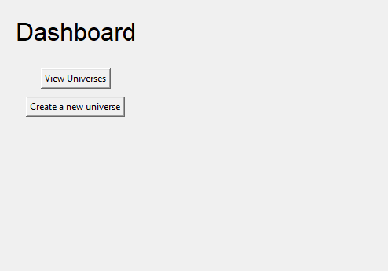
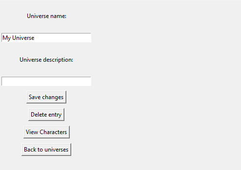
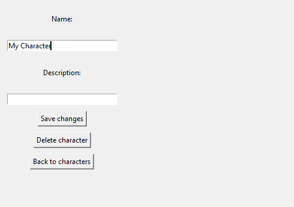

A simple desktop application that stores information pertaining to fictional universes and their characters. You can create, view, edit, and delete both characters and universes. Deleting a universe will also delete all associated characters.
Right now, characters and universes only have a name and description field.

When running the program, you will initially encounter the Dashboard Page. You can either view your existing universes or create a new one.

When creating a universe, you can enter a name and description for the new universe and save your changes. You will not be able to save it if the name field is empty, nor will you be able to create characters for the universe unless you save it first. The description field can be empty, however.

When viewing a universe, click on "View Characters" and "Create a New Character" to create a character for the associated universe. The process and restrictions are similar to creating a universe.

